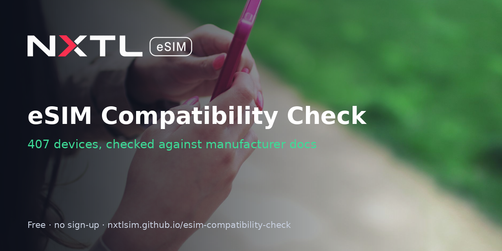

# eSIM Compatibility Check

**Live app:** https://nxtlsim.github.io/esim-compatibility-check/

Does my phone support eSIM? This page detects your device where the browser allows it and checks it against **407 phones, tablets, laptops and routers**, each verified against the manufacturer's own documentation. It also shows how to confirm on the device itself: dial `*#06#` for the EID, plus the settings paths. Works on phone and desktop and installs as an app (PWA). No sign-up, no trackers, and results are shareable by URL (`?m=Pixel 8`).

## Detection, with no permission prompts
- **Android Chromium:** `navigator.userAgentData.getHighEntropyValues(['model','platformVersion'])`, falling back to the user-agent string. Model numbers like `SM-S921B` match their family.
- **iPhone/iPad:** iOS doesn't expose the model to websites, so the page shows iPhone guidance: XS, XS Max, XR and later support eSIM, with exceptions such as some mainland-China models. You then pick your model from the list, where per-SKU exceptions are flagged (for example iPhone XR A2108, the mainland-China dual-physical-SIM version).

## Data and sources
`docs/devices.json` is a snapshot of NXTL's published compatibility dataset (https://nxtlsim.com/esim-compatible-devices/, reviewed 2026-09-09). Each entry links to its manufacturer sources, which are shown in the app. The source domains are:
- cgi.jp.sharp
- consumer.huawei.com
- corporate.jp.sharp
- dl.dell.com
- docs.crosscall.com
- docs.gl-inet.com
- en-emea.support.motorola.com
- en-gb.support.motorola.com
- en-in.support.motorola.com
- en-us.support.motorola.com
- es-es.support.motorola.com
- help.motorola.com
- helpguide.sony.net
- i.dell.com
- jp.sharp
- k-tai.sharp.co.jp
- network.mobile.rakuten.co.jp
- news.samsung.com
- press.hp.com
- psref.lenovo.com
- rog.asus.com
- support.apple.com
- support.fairphone.com
- support.google.com
- support.hp.com
- support.microsoft.com
- support.nothing.tech
- wiki.teltonika-networks.com
- www.asus.com
- www.crosscall.com
- www.dell.com
- www.fairphone.com
- www.hmd.com
- www.honor.com
- www.mi.com
- www.motorola.com
- www.oneplus.com
- www.oppo.com
- www.peplink.com
- www.samsung.com
- www.vivo.com

Statuses: Supports eSIM · Depends on configuration · Depends on region/version · Cellular version needed · Needs an eSIM adapter · No eSIM. A device missing from the list is not necessarily unsupported.

## Files
`docs/` index.html, manifest.json, sw.js, devices.json, icon-192.png, icon-512.png

MIT licence. Built by [NXTL eSIM](https://nxtlsim.com/?utm_source=github&utm_medium=readme&utm_campaign=esim-compatibility-check). Cover photo: JÉSHOOTS on Pexels.
